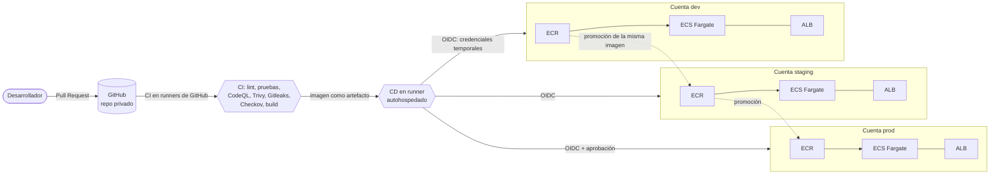
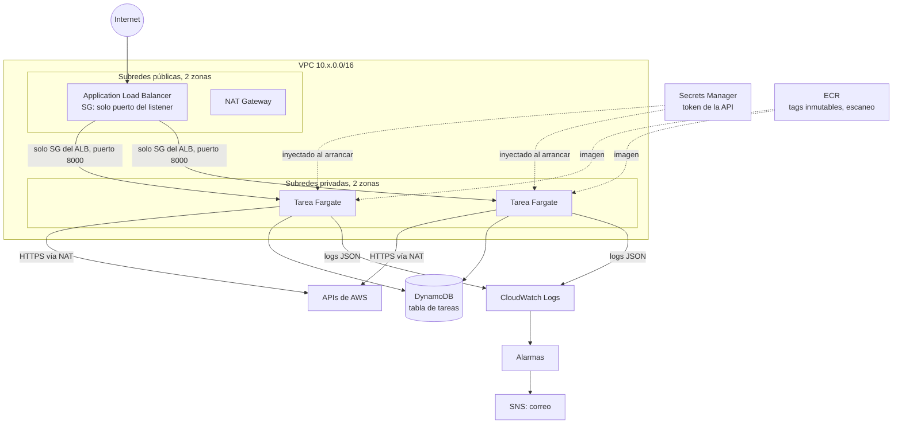
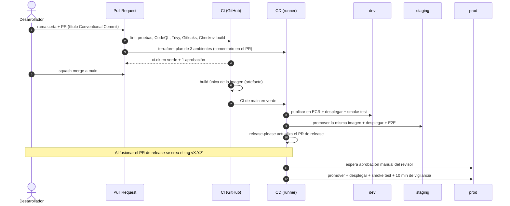

# Arquitectura

Este documento describe qué se despliega, cómo llega un cambio a producción y por qué se
tomó cada decisión. Los diagramas están en Mermaid: GitHub los dibuja al ver el archivo.

## Vista general

Cada ambiente vive en su propia cuenta de AWS (bajo AWS Organizations). Un error o un permiso
mal dado en dev no alcanza a producción. En la simulación, cada cuenta es una instancia
separada del emulador Floci con su propio ID de cuenta (111111111111, 222222222222 y
333333333333).

## Infraestructura de cada cuenta

| Componente | Módulo de Terraform | Decisiones |
| --- | --- | --- |
| Red | `infra/modules/network` | VPC con subredes públicas (solo ALB y NAT) y privadas (tareas). Un NAT compartido en dev y staging, uno por zona en prod. Flow logs a CloudWatch. Security group por defecto sin reglas. |
| Registro | `infra/modules/ecr` | Tags inmutables (un hash de commit siempre es la misma imagen), escaneo al subir, cifrado KMS, política de ciclo de vida y política de repositorio para que el ambiente siguiente descargue imágenes (promoción entre cuentas). |
| Balanceador | `infra/modules/alb` | Target group tipo `ip` (Fargate). Health check en `/health`. HTTPS opcional con certificado de ACM; con certificado, HTTP redirige a HTTPS. |
| Servicio | `infra/modules/ecs-service` | Rolling update (100 % mínimo, 200 % máximo) con circuit breaker y rollback. Tareas en subredes privadas sin IP pública. Rol de ejecución y rol de tarea separados. Secretos inyectados desde Secrets Manager. Sistema de archivos de solo lectura. |
| Observabilidad | `infra/modules/observability` | Métricas derivadas de los logs (solicitudes, 5xx, latencia), alarmas de 5xx, latencia, destinos no sanos y tareas caídas, notificación por SNS y un tablero por ambiente. |
| Datos | `infra/environments/*/main.tf` | Tabla DynamoDB por ambiente: la app no guarda estado, así que dos o más tareas detrás del ALB ven los mismos datos. |

### Quién decide qué versión corre

Terraform es dueño de la **forma** del servicio (CPU, memoria, variables, secretos, red). El
pipeline de CD es dueño de la **versión** (qué imagen corre). Para que no se pisen:

- El servicio de ECS ignora cambios de `task_definition` en Terraform (`ignore_changes`).
- El pipeline registra cada despliegue en el parámetro SSM `/tasks-api/<env>/image-tag`.
- Terraform lee ese parámetro y registra sus propias revisiones con la imagen que ya corre.
- El pipeline parte siempre de la última revisión registrada y solo cambia la imagen.

Así, un cambio de memoria en Terraform nunca despliega una imagen vieja, y un despliegue nunca
deshace un cambio de infraestructura. Un cambio de infraestructura en la definición de tarea
se activa en el siguiente despliegue (o con el workflow de rollback sobre la versión actual).

## Flujo de un cambio

## Seguridad

| Práctica | Implementación |
| --- | --- |
| Sin llaves de larga duración | OIDC: GitHub emite un token por job y `aws-actions/configure-aws-credentials` lo cambia por credenciales temporales de un rol (1 hora). No hay `AWS_ACCESS_KEY_ID` en GitHub. |
| Un rol por ambiente y función | `tasks-api-<env>-github-deploy` (desplegar la app), `-github-terraform` (aplicar Terraform) y `-github-plan` (solo lectura, para Pull Requests). Ver `infra/bootstrap/roles.tf`. |
| Confianza acotada | Deploy y Terraform: solo `repo:Luxzor/DevOps_Test:environment:<env>`. Plan: Pull Requests y `main` del mismo repositorio. Qué ramas usan cada Environment lo decide GitHub (solo `main`), y prod además exige revisor. |
| Sin escalada de privilegios | El rol de Terraform solo administra roles con el prefijo del ambiente y tiene un `Deny` explícito sobre los roles del pipeline. |
| Secretos fuera del repositorio | El token de la API se genera con un recurso efímero de Terraform (no queda en el estado) y vive en Secrets Manager; ECS lo inyecta al arrancar la tarea. |
| Cadena de suministro | Acciones de terceros fijadas por hash de commit, imágenes base por digest, lock files de Terraform con hashes de todas las plataformas, Dependabot para todo. |
| Análisis en CI | CodeQL (Python y workflows), Trivy (dependencias, secretos e imagen), Gitleaks (historial completo), Checkov (Terraform, con excepciones justificadas en el código). |
| Contenedor | Multi etapa, usuario no root (UID 10001), sin secretos, parches del sistema aplicados, solo lectura en ECS. |
| Red | Tareas en subredes privadas; solo aceptan tráfico del security group del ALB. |
| Estado de Terraform | S3 con versionado, cifrado, bloqueo de acceso público y política de solo TLS; bloqueo con DynamoDB. |

## Decisiones y alternativas

| Decisión | Alternativa descartada | Motivo |
| --- | --- | --- |
| ECS Fargate | Kubernetes (EKS) | Sin servidores ni plano de control que administrar; el modelo de despliegue es claro. Kubernetes queda como paso de crecimiento. |
| Una cuenta por ambiente | Un solo account con prefijos | Aislamiento real de permisos, cuotas y errores. Es la recomendación de AWS Organizations. |
| Promover copiando la imagen entre ECR | Reconstruir por ambiente | Lo que se probó en staging es exactamente lo que llega a prod (mismo digest). |
| Copia explícita entre registros | Replicación entre cuentas de ECR | La copia es visible en el pipeline y verifica el digest. La replicación nativa es una buena mejora en AWS real. |
| release-please | Tags manuales | La versión sale de los Conventional Commits y el CHANGELOG se escribe solo. |
| DynamoDB | RDS PostgreSQL | Sin servidor y sin migraciones para la fase 1. RDS queda para la fase 2 (migraciones en el pipeline). |
| Rollback en el pipeline además del circuit breaker | Solo circuit breaker | El circuit breaker detecta tareas que no arrancan; el smoke test detecta una versión que arranca pero responde mal. Además, el emulador no implementa el circuit breaker. |
| Floci | LocalStack | Floci no exige cuenta ni token y cubre ECS, ECR y ALB. Ver `docs/simulation.md`. |
